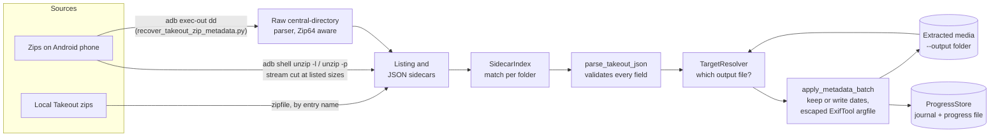

<p align="center">
  
</p>

<p align="center"><b>Restore dates, GPS, descriptions and people tags from Google Takeout JSON sidecars.</b></p>

<p align="center">
  <a href="LICENSE"></a>
  <a href="https://github.com/muhib-karim/google-takeout-metadata-fixer/actions/workflows/ci.yml"></a>
  
</p>

---

## What it is

When you export your library with Google Takeout, Google Photos puts each photo's metadata (capture time, location, description, people) in a separate JSON "sidecar" file. The photo files themselves often lose it. Import them into Apple Photos, Immich, Lightroom, PhotoPrism or a plain file browser and your timeline falls apart.

This project is a set of Python command-line tools. They read the sidecars straight from the Takeout zip archives, either on your computer or on an Android phone over ADB, work out which sidecar belongs to which photo or video, and use [ExifTool](https://exiftool.org) to write the metadata into the media files.

## Key features

- **Sidecar matching per album folder** (`SidecarIndex`) for the naming patterns Takeout produces:
  - the newer `photo.jpg.supplemental-metadata.json` format
  - sidecar names cut short at any point (`.supplemental-metad.json`, `.s.json`, `photo.jpg..json`), including cuts inside a long media name
  - Google duplicates, where the index must agree: `photo(2).jpg` → `photo.jpg.supplemental-metadata(2).json`, or `photo.jpg(2).json` in older exports
  - older formats: `photo.jpg.json`, `photo.json`
  - edited copies: 12 localized suffixes (`-edited`, `-bearbeitet`, `-modifié`, `-editado`, `-modificato`, `-bewerkt`, `-edytowany`, `-redigerad`, `-muokattu`, `-düzenlendi`, `-отредактировано`, `-編集済み`), also combined with a duplicate index
  - live photos: `IMG.mp4` / `IMG.mov` use the still image's sidecar
  - the sidecar's JSON `title` field, within the same folder, when names alone cannot decide
- **Embedded metadata, not just file timestamps:** `DateTimeOriginal`, `CreateDate`, `ModifyDate` with an explicit UTC offset, GPS latitude/longitude/altitude, `ImageDescription` and `XMP:PersonInImage`. Videos also get `TrackCreateDate`, `TrackModifyDate`, `MediaCreateDate` and `MediaModifyDate`.
- **Keeps what the camera recorded:** if a photo already holds a capture time that is the sidecar's instant in another time zone, it is left alone. `--overwrite-dates` forces the sidecar date.
- **Two sources:** local zip files, or zips left on an Android phone and streamed over ADB (only the JSON sidecars are read, so no local copy of the archives is needed).
- **Batched ExifTool calls:** 50 files per invocation, with a result for each file.
- **Resumable and honest about it:** every finished file is journaled as it happens, so an interrupted run continues where it stopped. A file ExifTool could not write is listed and retried with `--retry-failed`; a zip is only marked done when every entry has an outcome. `--dry-run` previews the work without touching files or progress.
- **Careful with untrusted input:** sidecar text is escaped before it reaches ExifTool, so a caption cannot be read as a command-line option.
- **Recovery path** (`recover_takeout_zip_metadata.py`): for zips whose on-device `unzip` listing is broken, it parses the zip central directory (including Zip64) from raw bytes read over `adb exec-out` + `dd`.

## Demo

A run of the fixer on a small synthetic Takeout zip (3 tiny JPEGs: a normal sidecar, a Google `(1)` duplicate and an `-edited` copy with a truncated sidecar), followed by an ExifTool check. The capture is from version 1.0; the current version prints a few more summary lines.

<p align="center">
  
</p>

## Quick start

```bash
git clone https://github.com/muhib-karim/google-takeout-metadata-fixer.git
cd google-takeout-metadata-fixer
python google_takeout_metadata_fixer.py --output ./Output --local-zips ./takeout-zips --dry-run
```

Drop `--dry-run` to write the metadata. Nothing needs to be installed with pip: the fixer, extractor, copy helper and recovery helper use only the Python standard library.

### Requirements

- Python 3.10 or newer (CI tests 3.10 to 3.15)
- [ExifTool](https://exiftool.org/install.html) on your `PATH` (`sudo apt install libimage-exiftool-perl`, `brew install exiftool`, or the Windows executable)
- [ADB](https://developer.android.com/tools/releases/platform-tools) on your `PATH`, only for the phone modes
- `pip install -r requirements.txt`, only for the optional `google_photos_downloader.py`

### Privacy

Your photos and their metadata stay on your machine. The fixer, extractor, copy helper and recovery helper make no network connections: they read local files, run ExifTool locally, and talk to a phone you attached over USB through ADB. There is no telemetry.

The one exception is the optional `google_photos_downloader.py`, which by design contacts Google's Photos API with an OAuth client you create yourself.

## Usage

### 1. Fix metadata on already-extracted media

`--output` is the folder containing your extracted photos and videos. Files are matched by filename against the media entries in each zip.

```bash
# Zips on your computer
python google_takeout_metadata_fixer.py --output ./Output --local-zips ./takeout-zips

# Zips on an Android phone (USB debugging enabled)
python google_takeout_metadata_fixer.py --output ./Output --phone-dir /sdcard/Download

# Preview without modifying files or saving progress
python google_takeout_metadata_fixer.py --output ./Output --local-zips ./takeout-zips --dry-run
```

| Option | Effect |
|---|---|
| `--dry-run` | Show what would be done; no file and no progress is written |
| `--overwrite-dates` | Always write the sidecar date, even over a consistent camera time |
| `--retry-failed` | Try again the files ExifTool reported an error for in an earlier run |

Progress is kept in `fix_metadata_progress.json` in the directory you run the command from, so run it from the same place to resume. Delete that file to start over.

### 2. Extract media and apply metadata in one pass

`extract_takeout_media.py` extracts media one file at a time into a single flat folder, renaming clashes to `name_1.jpg`, and writes dates, GPS, descriptions and people tags as it goes. A photo whose sidecar is missing or unreadable is still extracted, and an interrupted run continues without duplicating files.

```bash
python extract_takeout_media.py ./takeout-zips --output ./Output       # zips in a local folder / mounted drive
python extract_takeout_media.py --adb /sdcard/Download --output ./Output  # pulls one zip at a time over ADB
```

### 3. Copy the result back to the phone (resumable)

```bash
python adb_resumable_copy.py --source-dir ./Output --dest-dir /sdcard/Download/Output
```

Files already on the device with a matching size are skipped, so you can re-run the command after a disconnect.

### 4. Recover metadata from a zip with a broken listing

```bash
python recover_takeout_zip_metadata.py --remote-zip /sdcard/Download/takeout-XXXX.zip --output ./Output
```

### Verify the result

```bash
exiftool -DateTimeOriginal -CreateDate -GPSLatitude -GPSLongitude -XMP:PersonInImage "Output/IMG_0001.jpg"
```

## Architecture



- **`google_takeout_metadata_fixer.py`** is the core. It holds sidecar matching (`SidecarIndex`), sidecar parsing, the date rule and ExifTool batching (`apply_metadata_batch`), target resolution (`TargetResolver`), resume state (`ProgressStore`), the ADB and local zip readers, and the main loop. The recovery helper imports these.
- **`extract_takeout_media.py`** extracts and fixes in one pass. It uses the same matcher, parser and writer as the fixer, stages each file inside the output folder and renames it into place when it is complete.
- **`adb_resumable_copy.py`** pushes files to the device, skipping ones whose size already matches.
- **`recover_takeout_zip_metadata.py`** handles zips the phone's `unzip` can't list reliably. It pushes one shell script that reads every JSON's local header and data in a single ADB call, then decompresses with `zlib` on the host.
- **`google_photos_downloader.py`** is an optional downloader that uses the Google Photos Library API with your own OAuth client.

## Testing

The test suite builds every fixture itself (an embedded 8×8 JPEG, generated PNG and MP4 files, synthetic Takeout zips in a temp directory), so no real photos, locations or names are stored in the repo, and no imaging library is needed. It has more than 240 tests:

- unit tests for sidecar matching, sidecar parsing, ExifTool argument generation and sidecar pairing
- round-trips through the real ExifTool that read the written tags back: dates and time zones, GPS in all four hemispheres on JPEG, PNG and MP4, multi-line and hostile captions
- resume behaviour: interrupted runs, failed batches, damaged progress files, same-named photos from different albums
- the phone mode, driven end to end against a stand-in for `adb` ([`tests/fake_adb.py`](tests/fake_adb.py))
- zip central-directory parsing checked against Python's `zipfile`, and `--help` smoke tests for every CLI

```bash
pip install -r requirements-dev.txt
sudo apt-get install -y libimage-exiftool-perl   # tests marked "exiftool" are skipped if it is missing
ruff check .
mypy
python -m pytest -v
```

GitHub Actions ([`ci.yml`](.github/workflows/ci.yml)) runs ruff and mypy, the test suite on Python 3.10 to 3.15, a gitleaks scan of the full history and `pip-audit`, for every push and pull request and once a week. Dependabot proposes updates for the pinned tools and actions.

## Project structure

```text
.
├── google_takeout_metadata_fixer.py   # main fixer: matching, parsing, ExifTool batching, resume
├── extract_takeout_media.py           # extract media from zips (local or ADB) and apply metadata
├── recover_takeout_zip_metadata.py    # raw zip central-directory recovery over ADB
├── adb_resumable_copy.py              # resumable copy back to an Android device
├── google_photos_downloader.py        # optional Google Photos API downloader
├── tests/                             # pytest suite with generated fixtures and a stand-in adb
├── docs/                              # banner and demo images
├── assets/icon.svg                    # project icon
├── pyproject.toml                     # project metadata, ruff, mypy and pytest configuration
├── requirements.txt                   # downloader dependencies
├── requirements-dev.txt               # pinned test, lint and audit tools
├── CHANGELOG.md
└── .github/
    ├── workflows/ci.yml               # lint, type check, tests, secret scan, dependency audit
    └── dependabot.yml                 # weekly updates for pip and GitHub Actions
```

## Limitations and roadmap

- The fixer only indexes files at the top level of `--output`, not subfolders. This matches the flat layout produced by `extract_takeout_media.py`.
- A sidecar is only looked for in the same zip as its media file. Takeout sometimes puts the two in different parts of a multi-part export; those files are counted under "No JSON sidecar found".
- Takeout sidecars store the capture instant in UTC, not the local time. When a date has to be written to a photo it is written as UTC with an explicit `+00:00` offset; a photo that already has a consistent camera time keeps it. Videos always get UTC, which is what their date fields are defined to hold.
- In a flat output folder, two different photos with the same file name can only be told apart by file size or by a capture time already in the file. If neither identifies them, they are reported as ambiguous and left untouched.
- ExifTool cannot write AVI, MKV, WebM or BMP files. They are listed as errors once and then skipped.
- Favourite status is parsed but not written to files.
- ADB mode is exercised only through manual use. The automated tests cover local-zip mode and the pure logic.
- Google restricted the Photos Library API's `photoslibrary.readonly` scope in 2025, so `google_photos_downloader.py` may no longer be able to list a full library. Takeout is the reliable export path.

Related projects that tackle the same problem: [GooglePhotosTakeoutHelper](https://github.com/TheLastGimbus/GooglePhotosTakeoutHelper), [google-photos-migrate](https://github.com/garzj/google-photos-migrate).

## Contributing

Issues and pull requests are welcome, especially new Takeout naming edge cases (please include anonymized file names), more edited-suffix languages, and matching heuristics with a test case.

## Support

If this project saved you time, you can support maintenance on [Ko-fi](https://ko-fi.com/ai_dev_2024).

[](https://startup.z.ai/)

## License

[MIT](LICENSE)
