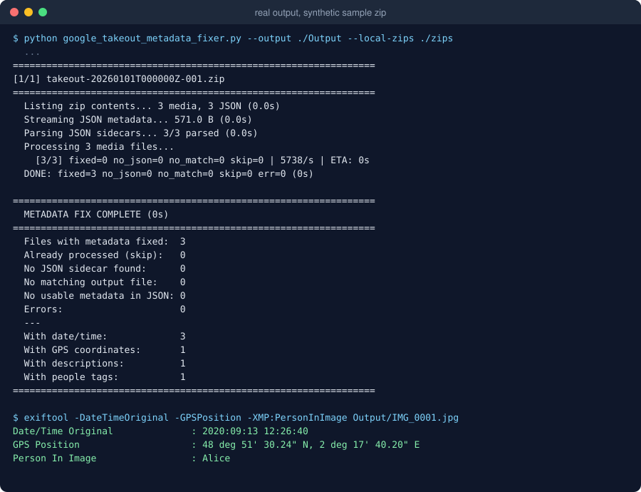
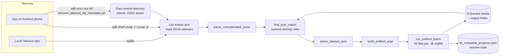

<p align="center">
  
</p>

<p align="center"><b>Restore dates, GPS, descriptions and people tags from Google Takeout JSON sidecars.</b></p>

<p align="center">
  <a href="LICENSE"></a>
  
  <a href="https://github.com/muhib-karim/google-takeout-metadata-fixer/actions/workflows/ci.yml"></a>
</p>

---

## What it is

When you export your library with Google Takeout, Google Photos puts each photo's metadata (capture time, location, description, people) in a separate JSON "sidecar" file. The photo files themselves often lose it. Import them into Apple Photos, Immich, Lightroom, PhotoPrism or a plain file browser and your timeline falls apart.

This project is a set of Python command-line tools. They read the sidecars straight from the Takeout zip archives, either on your computer or on an Android phone over ADB, work out which sidecar belongs to which photo or video, and use [ExifTool](https://exiftool.org) to write the metadata into the media files.

## Key features

- **Layered sidecar matching** (`find_json_match`) for the naming patterns Takeout produces:
  - the newer `photo.jpg.supplemental-metadata.json` format, including duplicate indexes `…(1).json`
  - truncated sidecar names (`.supplemental-metad.json`, `.supple.json`, `.s.json`)
  - Google duplicates: `photo(2).jpg` → `photo.jpg.supplemental-metadata(2).json`
  - older formats: `photo.jpg.json`, `photo.json`, `photo.jpg(1).json`
  - edited copies: 12 localized suffixes (`-edited`, `-bearbeitet`, `-modifié`, `-editado`, `-modificato`, `-bewerkt`, `-edytowany`, `-redigerad`, `-muokattu`, `-düzenlendi`, `-отредактировано`, `-編集済み`)
  - live photos: `IMG.mp4` / `IMG.mov` inherit the still image's sidecar
  - fallback to the sidecar's JSON `title` field
- **Embedded metadata, not just file timestamps:** `DateTimeOriginal`, `CreateDate`, `ModifyDate`, GPS lat/long/altitude with N/S/E/W refs, `ImageDescription` and `XMP:PersonInImage`. Videos also get `TrackCreateDate`, `TrackModifyDate`, `MediaCreateDate` and `MediaModifyDate`.
- **Two sources:** local zip files, or zips left on an Android phone and streamed over ADB (only the JSON sidecars are read, so no local copy of the archives is needed).
- **Batched ExifTool calls:** 50 files per invocation through an `-@` argfile.
- **Resumable:** a progress file records completed zips and entries, so an interrupted run picks up where it stopped. `--dry-run` previews the work without touching files or progress.
- **Recovery path** (`recover_takeout_zip_metadata.py`): for zips whose on-device `unzip` listing is broken, it parses the zip central directory (including Zip64) from raw bytes read over `adb exec-out` + `dd`.

## Demo

A real run of the fixer on a small synthetic Takeout zip (3 tiny JPEGs: a normal sidecar, a Google `(1)` duplicate and an `-edited` copy with a truncated sidecar), followed by an ExifTool check:

<p align="center">
  
</p>

## Quick start

### Requirements

- Python 3.9+ (CI tests 3.9, 3.11 and 3.12)
- [ExifTool](https://exiftool.org/install.html) on your `PATH` (`sudo apt install libimage-exiftool-perl`, `brew install exiftool`, or the Windows executable)
- [ADB](https://developer.android.com/tools/releases/platform-tools) on your `PATH`, only for the phone modes

```bash
git clone https://github.com/muhib-karim/google-takeout-metadata-fixer.git
cd google-takeout-metadata-fixer
pip install -r requirements.txt   # only needed for the optional google_photos_downloader.py
```

The metadata fixer, extractor, copy helper and recovery helper use only the Python standard library.

## Usage

### 1. Fix metadata on already-extracted media

`--output` is the folder containing your extracted photos and videos. Files are matched by filename against the media entries in each zip.

```bash
# Zips on your computer
python google_takeout_metadata_fixer.py --output ./Output --local-zips ./takeout-zips

# Zips on an Android phone (USB debugging enabled)
python google_takeout_metadata_fixer.py --output ./Output --phone-dir /sdcard/Download

# Preview without modifying files or saving progress
python google_takeout_metadata_fixer.py --output ./Output --local-zips ./takeout-zips --dry-run
```

### 2. Extract media and apply metadata in one pass

`extract_takeout_media.py` extracts media one file at a time into a single flat folder, renaming clashes to `name_1.jpg`, and writes dates, GPS and descriptions as it goes.

```bash
python extract_takeout_media.py ./takeout-zips --output ./Output       # zips in a local folder / mounted drive
python extract_takeout_media.py --adb /sdcard/Download --output ./Output  # pulls one zip at a time over ADB
```

### 3. Copy the result back to the phone (resumable)

```bash
python adb_resumable_copy.py --source-dir ./Output --dest-dir /sdcard/Download/Output
```

Files already on the device with a matching size are skipped, so you can re-run the command after a disconnect.

### 4. Recover metadata from a zip with a broken listing

```bash
python recover_takeout_zip_metadata.py --remote-zip /sdcard/Download/takeout-XXXX.zip --output ./Output
```

### Verify the result

```bash
exiftool -DateTimeOriginal -CreateDate -GPSLatitude -GPSLongitude -XMP:PersonInImage "Output/IMG_0001.jpg"
```

## Architecture



- **`google_takeout_metadata_fixer.py`** is the core. It holds the matching rules, sidecar parsing, ExifTool argument building and batching, the ADB and local zip readers, and the resumable main loop. The recovery helper imports these functions.
- **`extract_takeout_media.py`** is a standalone extract-and-fix pipeline with its own (simpler) matcher.
- **`adb_resumable_copy.py`** pushes files to the device, skipping ones whose size already matches.
- **`recover_takeout_zip_metadata.py`** handles zips the phone's `unzip` can't list reliably. It pushes one shell script that reads every JSON's local header and data in a single ADB call, then decompresses with `zlib` on the host.
- **`google_photos_downloader.py`** is an optional downloader that uses the Google Photos Library API with your own OAuth client.

## Testing

The test suite builds tiny fixtures on the fly (8×8 JPEGs from Pillow, synthetic Takeout zips in a temp directory), so no real photos are stored in the repo. It has 58 tests:

- unit tests for every matching rule, sidecar parsing, ExifTool argument generation and the JSON stream splitter
- zip central-directory parsing checked against Python's `zipfile`
- `--help` smoke tests for every CLI
- end-to-end runs that call the real ExifTool and read the written tags back, covering resume and dry-run behaviour

```bash
pip install -r requirements-dev.txt
sudo apt-get install -y libimage-exiftool-perl   # end-to-end tests are skipped if exiftool is missing
ruff check .
python -m pytest -v
```

GitHub Actions ([`ci.yml`](.github/workflows/ci.yml)) runs `ruff check .` and runs the test suite on Python 3.9, 3.11 and 3.12 for every push and pull request.

## Project structure

```text
.
├── google_takeout_metadata_fixer.py   # main fixer: matching, parsing, ExifTool batching, resume
├── extract_takeout_media.py           # extract media from zips (local or ADB) and apply metadata
├── recover_takeout_zip_metadata.py    # raw zip central-directory recovery over ADB
├── adb_resumable_copy.py              # resumable copy back to an Android device
├── google_photos_downloader.py        # optional Google Photos API downloader
├── tests/                             # pytest suite with generated fixtures
├── docs/                              # banner and demo images
├── assets/icon.svg                    # project icon
├── pyproject.toml                     # ruff + pytest configuration
├── requirements.txt                   # downloader dependencies
├── requirements-dev.txt               # test/lint dependencies
└── .github/workflows/ci.yml           # lint + test CI
```

## Limitations and roadmap

- The fixer only indexes files at the top level of `--output`, not subfolders. This matches the flat layout produced by `extract_takeout_media.py`.
- Timestamps are written as UTC wall-clock time, because Takeout sidecars store a UTC epoch. No local-timezone offset is applied.
- Favourite status is parsed but not written to files.
- `extract_takeout_media.py` has its own simpler matcher and doesn't write people tags. Folding it into the shared matcher is a natural next step.
- ADB mode is exercised only through manual use. The automated tests cover local-zip mode and the pure logic.
- Google restricted the Photos Library API's `photoslibrary.readonly` scope in 2025, so `google_photos_downloader.py` may no longer be able to list a full library. Takeout is the reliable export path.

Related projects that tackle the same problem: [GooglePhotosTakeoutHelper](https://github.com/TheLastGimbus/GooglePhotosTakeoutHelper), [google-photos-migrate](https://github.com/garzj/google-photos-migrate).

## Contributing

Issues and pull requests are welcome, especially new Takeout naming edge cases (please include anonymized file names), more edited-suffix languages, and matching heuristics with a test case.

## Support

If this project saved you time, you can support maintenance on [Ko-fi](https://ko-fi.com/ai_dev_2024).

[](https://startup.z.ai/)

## License

[MIT](LICENSE)
